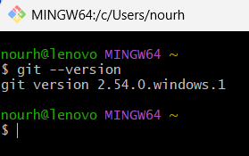
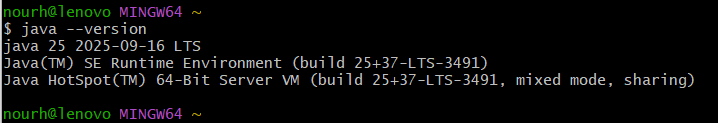
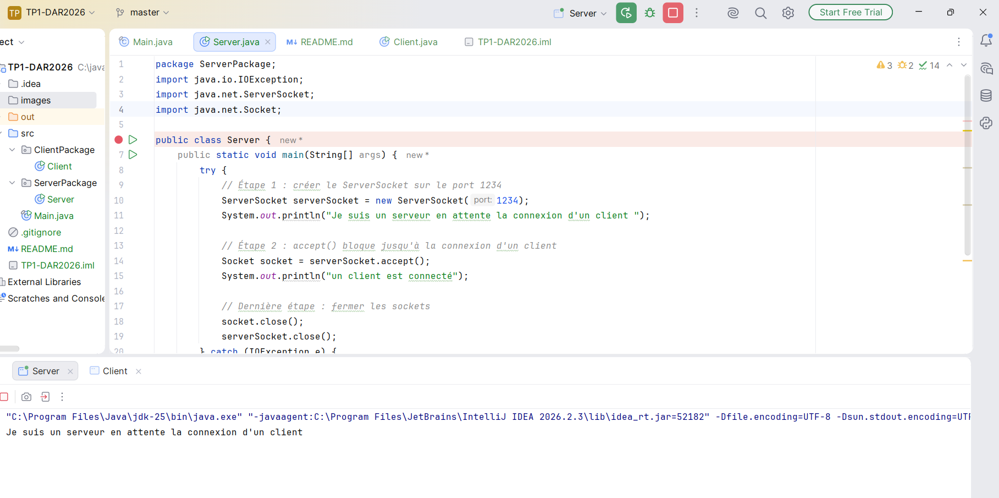
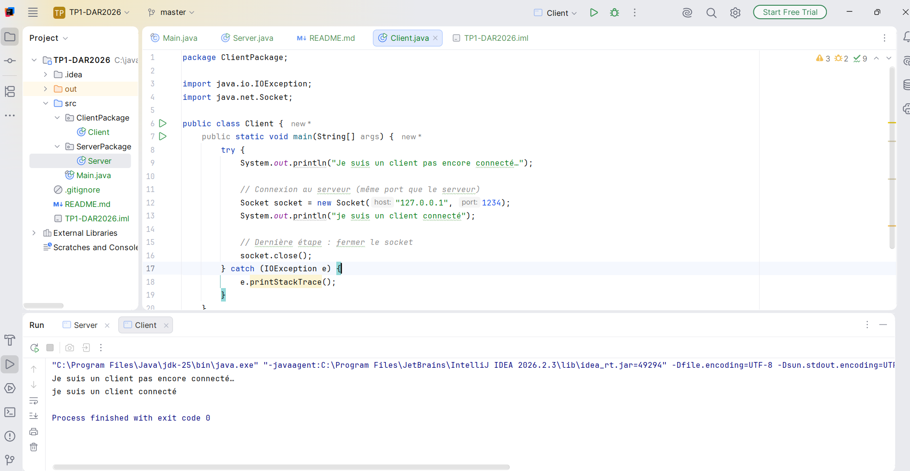
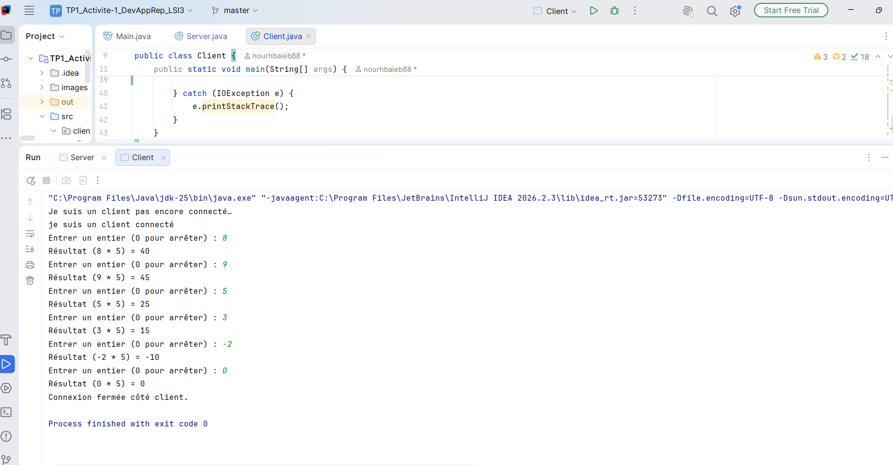
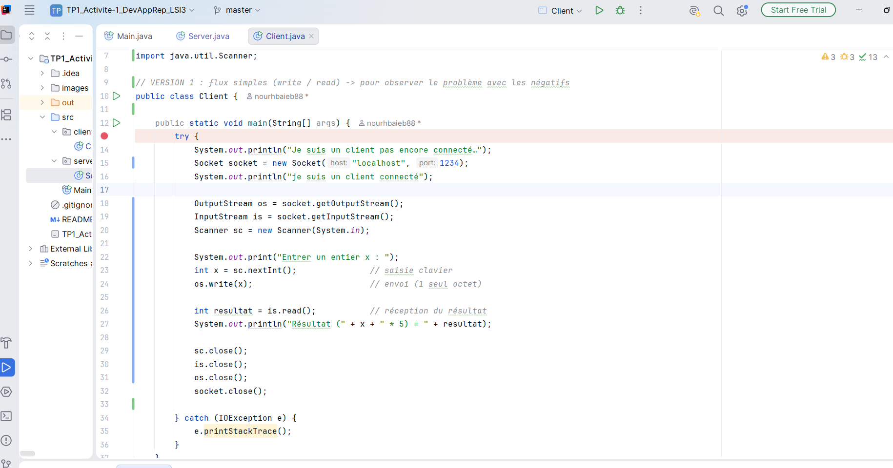
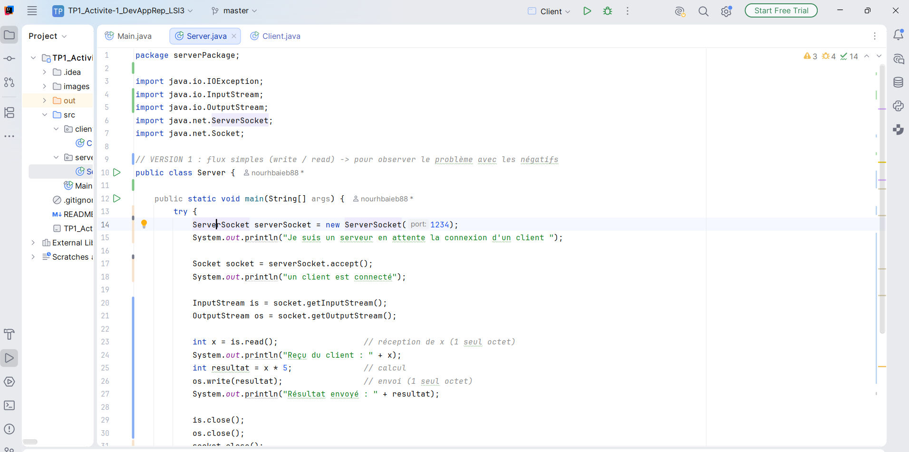

# TP1 — Sockets TCP en mode connecté

**Matière :** Développement d’applications réparties
**Niveau :** LSI 3
**Projet :** `TP1-DAR2026`

Ce TP met en place une communication TCP entre une application cliente Java et une application serveur Java. Le serveur écoute sur le port `1234`. Le client peut d’abord établir une connexion, puis envoyer des entiers au serveur afin qu’il calcule leur produit par `5`.

## Organisation du projet

```text
src/
├── clientPackage/
│   └── Client.java
└── serverPackage/
    └── Server.java
images/
```

Le serveur doit être démarré avant le client. Les deux programmes doivent utiliser le même port (`1234`).

# Activité 1-1 — Première connexion TCP

## Étape 1 — Vérification de Git et de Java

### Description

Avant de commencer le développement, j’ai vérifié que Git et Java étaient installés et accessibles depuis le terminal avec les commandes `git --version` et `java --version`.

### Interprétation

Les versions affichées confirment que l’environnement est prêt pour gérer le projet avec Git et compiler ou exécuter les programmes Java.





## Étape 2 — Création du serveur

### Description

La classe `serverPackage.Server` crée un `ServerSocket` sur le port `1234`. Le serveur affiche son message d’attente, puis appelle `accept()`. Cet appel est bloquant : le programme attend qu’un client établisse une connexion.

```java
ServerSocket serverSocket = new ServerSocket(1234);
System.out.println("Je suis un serveur en attente la connexion d'un client ");

Socket socket = serverSocket.accept();
System.out.println("un client est connecté");
```

Une fois la connexion acceptée, le serveur ferme le socket client et le socket d’écoute.

### Interprétation

Le message d’attente apparaît avant le lancement du client. Dès que le client se connecte, `accept()` retourne et le serveur affiche `un client est connecté`.



## Étape 3 — Connexion du client

### Description

La classe `clientPackage.Client` ouvre un `Socket` vers le serveur sur le port `1234`. Pour un essai sur la même machine, l’adresse est `localhost`. Le client peut aussi utiliser l’adresse IP de la machine qui exécute le serveur.

```java
System.out.println("Je suis un client pas encore connecté…");
Socket socket = new Socket("localhost", 1234);
System.out.println("je suis un client connecté");
```

### Interprétation

Le client affiche d’abord son état avant connexion, puis confirme la connexion établie. En réseau, il faut remplacer `localhost` par l’adresse IP du serveur et autoriser le port `1234` dans le pare-feu si nécessaire.



# Activité 1-2 — Service de calculatrice

Le client saisit un entier `x` au clavier avec `Scanner`. Il l’envoie au serveur, qui calcule `x * 5` et renvoie le résultat. Les deux côtés doivent utiliser le même format de transmission et lire/écrire les données dans le même ordre.

## Étape 1 — Première version avec `write()` et `read()`

### Description

Dans la première version, le client lit l’entier puis le transmet avec `OutputStream.write()`. Le serveur le lit avec `InputStream.read()`, calcule le produit par `5`, puis renvoie le résultat de la même manière.

Extrait côté client :

```java
int x = sc.nextInt();
os.write(x);

int resultat = is.read();
System.out.println("Résultat (" + x + " * 5) = " + resultat);
```

Extrait côté serveur :

```java
int x = is.read();
int resultat = x * 5;
os.write(resultat);
```

### Interprétation

Cette version ne transmet pas un entier Java complet. `OutputStream.write(int)` envoie uniquement les 8 bits de poids faible de sa valeur. De son côté, `InputStream.read()` renvoie un octet sous forme d’une valeur comprise entre `0` et `255` (ou `-1` pour signaler la fin du flux). Le signe et les bits de poids fort sont donc perdus. De plus, l’octet du résultat est lui aussi tronqué.

Ainsi, pour `-3`, l’octet reçu vaut `253` ; le serveur calcule `253 * 5 = 1265`, puis n’envoie que l’octet bas, soit `241`. Pour `100`, le produit `500` est tronqué à `244`. Ces valeurs ne sont pas les résultats mathématiques attendus.


## Étape 2 — Transmission correcte avec `DataInputStream` et `DataOutputStream`

### Description

Pour transmettre un entier signé sur 4 octets, les flux simples sont remplacés par `DataOutputStream` et `DataInputStream`. Le client envoie `x` avec `writeInt()` et lit le résultat avec `readInt()`. Le serveur utilise les mêmes méthodes, dans l’ordre correspondant.

Extrait côté client :

```java
DataOutputStream out = new DataOutputStream(socket.getOutputStream());
DataInputStream in = new DataInputStream(socket.getInputStream());

out.writeInt(x);
out.flush();
int resultat = in.readInt();
```

Extrait côté serveur :

```java
DataInputStream in = new DataInputStream(socket.getInputStream());
DataOutputStream out = new DataOutputStream(socket.getOutputStream());

int x = in.readInt();
int resultat = x * 5;
out.writeInt(resultat);
out.flush();
```

### Interprétation

`writeInt()` et `readInt()` échangent l’entier sous forme de quatre octets et préservent son signe. Les essais confirment les résultats attendus, y compris pour une valeur négative et une valeur supérieure à `255`.


## Étape 3 — Traitement en boucle et fermeture de la connexion

### Description

Le client et le serveur utilisent une boucle `do-while` : chaque entier est envoyé, traité et renvoyé. La boucle continue tant que `x` est différent de `0`. Le client reçoit donc aussi la réponse `0`, puis les deux programmes quittent la boucle et ferment leurs flux et leurs sockets.

```java
int x;
do {
    x = sc.nextInt();
    out.writeInt(x);
    out.flush();

    int resultat = in.readInt();
    System.out.println("Résultat (" + x + " * 5) = " + resultat);
} while (x != 0);

in.close();
out.close();
socket.close();
System.out.println("Connexion fermée côté client.");
```

Sur le serveur, le même principe s’applique après chaque réception : calculer `x * 5`, renvoyer le résultat avec `writeInt()`, puis continuer tant que `x != 0`. Après la valeur sentinelle, le serveur ferme ses flux, le socket client et le `ServerSocket`.

### Interprétation

L’entrée `0` sert de signal d’arrêt : le serveur renvoie d’abord `0`, puis les deux côtés ferment la connexion. Les messages de confirmation sont `Connexion fermée côté client.` et `Connexion fermée côté serveur.`.







## Comparaison des résultats

| Version / valeur saisie | Résultat attendu (`x * 5`) | Résultat obtenu | Interprétation |
|---|---:|---:|---|
| Flux simples — `x = 4` | `20` | `20` | Valeur positive représentable sur un octet : le cas fonctionne. |
| Flux simples — `x = -3` | `-15` | `241` | L’octet reçu est interprété comme `253`, puis le résultat est tronqué. |
| Flux simples — `x = 100` | `500` | `244` | Le produit est réduit à son octet de poids faible. |
| Flux simples — `x = 0` | `0` | `0` | La valeur zéro est représentable sur un octet. |
| `DataOutputStream` / `DataInputStream` — `x = 4` | `20` | `20` | Entier transmis sur 4 octets. |
| `DataOutputStream` / `DataInputStream` — `x = -3` | `-15` | `-15` | Le signe est conservé. |
| `DataOutputStream` / `DataInputStream` — `x = 100` | `500` | `500` | Les bits de poids fort du résultat sont conservés. |
| `DataOutputStream` / `DataInputStream` — `x = 0` | `0` | `0` | Le serveur répond `0`, puis les deux côtés terminent leur boucle. |

## Lancement

1. Lancer `serverPackage.Server`.
2. Lancer `clientPackage.Client`.
3. Saisir les entiers à traiter dans la console du client.
4. Saisir `0` pour terminer l’échange et fermer les connexions.

## Dépôt GitHub

Repository : [nourhbaieb88/TP1-DAR2026](https://github.com/nourhbaieb88/TP1-DAR2026)

Pour ajouter les modifications, créer un commit et les envoyer au dépôt distant :

```bash
git add .
git commit -m "Compléter le README du TP1"
git push
```
